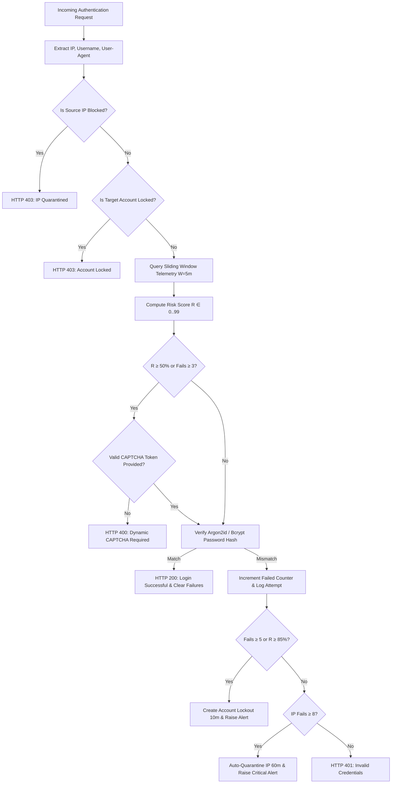
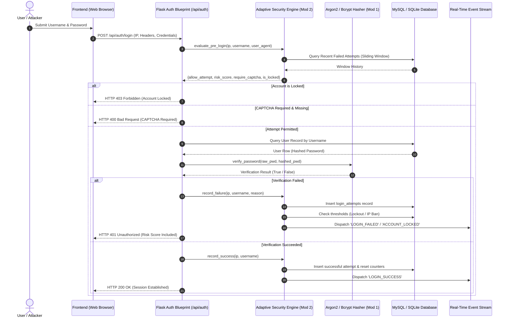
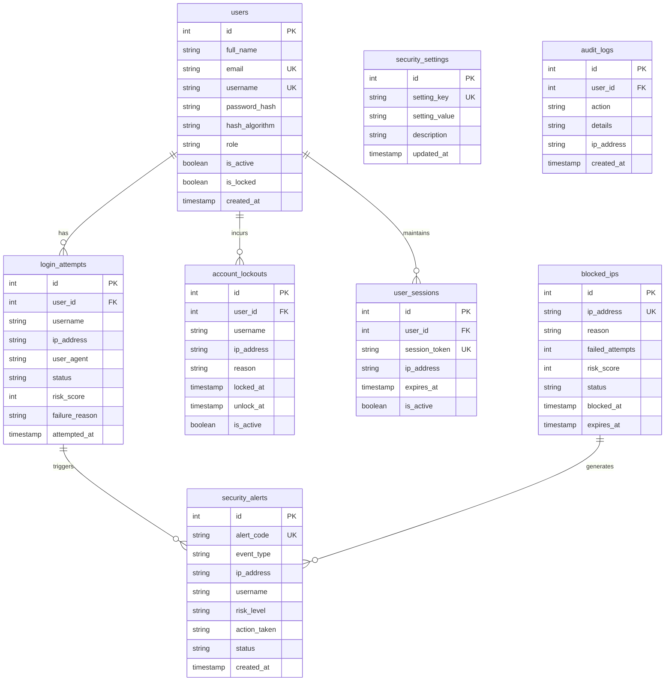

# Academic Project Report
## Adaptive Authentication Security System for Real-Time Brute-Force Attack Detection and Prevention
### Project Codename: SentinelShield (AASS)

---

### Project Metadata & Team Allocation

- **Domain**: Ethical Hacking, Web Application Security, Threat Intelligence & Defensive Engineering
- **Academic Year**: 2026
- **Architecture**: Full-Stack SaaS (RESTful API, Dual Database Engine, HTML5 Server-Sent Events)

#### Module Specifications:
| Module Identifier | Module Designation | Architectural Subsystem | Core Engineering Focus |
| :--- | :--- | :--- | :--- |
| **Module 1** | **Adaptive User Authentication & Login Management** | **Identity & Access Core** | User Registration, Cryptographic Password Hashing (Argon2id & Bcrypt Dual Engine), Secure Session State, Forensic Audit Trails, User Directory Administration. |
| **Module 2** | **Real-Time Brute-Force Attack Detection & Prevention** | **Threat Defense Engine** | Real-Time Sliding-Window Attack Detection, Dynamic Risk Scoring Engine ($0-100\%$), Dynamic CAPTCHA Generation & Verification, IP Tracking & Automated Quarantine, Defensive Account Lockout, Live Threat Radar. |

---

## 1. Abstract

Authentication remains the primary perimeter defending modern web applications and organizational assets. However, conventional authentication architectures rely on static, binary defense models (accept or reject based solely on credential matching). Consequently, web applications remain vulnerable to automated credential stuffing, high-frequency brute-force dictionary attacks, distributed botnet credential probing, and slow "low-and-slow" attacks designed to bypass naive rate limiters.

This project, **"Adaptive Authentication Security System for Real-Time Brute-Force Attack Detection and Prevention" (SentinelShield)**, introduces a multi-layered, risk-driven, real-time security architecture. Rather than relying on rigid rules, the system employs an **Adaptive Security Engine** that evaluates real-time forensic telemetry—such as login velocity per IP, target account velocity, user agent characteristics, geographic anomalies, and previous failure penalties—to compute a dynamic **Risk Score ($R \in [0, 99]$)** for every authentication attempt. 

Based on this score, the system dynamically enforces graduated defensive countermeasures:
1. **Low Risk ($R < 50\%$)**: Seamless credential verification with Argon2id / Bcrypt password hashing.
2. **Elevated Risk ($50\% \le R < 85\%$ or $\ge 3$ failed attempts)**: Dynamic anti-automation challenge (CAPTCHA with cryptographic server-side validation).
3. **Severe Risk ($R \ge 85\%$ or $\ge 5$ failed attempts)**: Immediate temporary account lockout (default 10 minutes) with security alerts.
4. **Malicious Network Threat (High IP velocity)**: Automated source IP quarantine (default 60 minutes) blocking inbound traffic at the edge.

All events are broadcast in real time using Server-Sent Events (SSE) to an interactive, light-themed enterprise dashboard featuring live threat radars, interactive Chart.js visualizations, and an administrative control plane.

---

## 2. Problem Statement & Motivation

### 2.1 The Threat Landscape
Automated brute-force and credential stuffing attacks represent over 80% of all authentication-related security breaches worldwide (OWASP A07:2021). Attackers employ distributed botnets (e.g., Mirai, Tor exit nodes, residential proxies) combined with automated tools (Hydra, Medusa, Burp Suite Intruder) to execute millions of password attempts against exposed endpoints.

### 2.2 Limitations of Existing Systems
Traditional web application authentication systems suffer from fundamental architectural weaknesses:
1. **Static Thresholds**: Hardcoded rules (e.g., "lock after 5 failed attempts") are easily circumvented by rotating IP addresses or delaying requests ("low-and-slow" attacks).
2. **Denial-of-Service (DoS) Susceptibility**: Indiscriminate account lockouts allow malicious actors to intentionally lock out legitimate executive accounts simply by guessing bad passwords.
3. **Passive Logging**: Security logs are written to flat files or databases without active, real-time alerting or defensive mitigation.
4. **Weak or Outdated Cryptography**: Widespread use of legacy hash algorithms (MD5, SHA-1, or unsalted SHA-256) susceptible to GPU-accelerated rainbow table cracking.
5. **No Contextual Risk Assessment**: A login attempt from an internal corporate subnet is treated with the same suspicion as an automated script executing from a Tor exit node.

---

## 3. Mathematical Formulation of the Adaptive Security Engine

The core analytical engine of SentinelShield computes a real-time risk score $R$ for each incoming authentication request $q = (u, ip, ua, t)$, where $u$ is the target username, $ip$ is the client IP address, $ua$ is the client User-Agent header, and $t$ is the current timestamp.

### 3.1 Velocity Metric Formulations
Within a configurable sliding time window $W$ (default: $W = 300\text{ seconds}$), we define:

- **IP-Based Failure Velocity ($V_{ip}$)**:
  $$V_{ip} = \sum_{i \in \text{Attempts}(ip, W)} \mathbf{1}_{\{\text{status}_i \neq \text{'SUCCESS'}\}}$$

- **User-Based Failure Velocity ($V_u$)**:
  $$V_u = \sum_{j \in \text{Attempts}(u, W)} \mathbf{1}_{\{\text{status}_j \neq \text{'SUCCESS'}\}}$$

### 3.2 Dynamic Risk Scoring Equation
The total composite Risk Score $R(q)$ is formulated as:

$$R(q) = \min\left(99, \; w_{base} + w_{ip} \cdot V_{ip} + w_u \cdot V_u + S_{agent} + S_{geo}\right)$$

Where:
- $w_{base} \in [0, 5]$: Baseline ambient network risk.
- $w_{ip} = 15$: Weight assigned to failed attempts originating from the same IP address.
- $w_u = 12$: Weight assigned to failed attempts targeting the specific user account.
- $S_{agent} \in [0, 25]$: Automated tool signature penalty:
  $$S_{agent} = \begin{cases} 
  25 & \text{if } ua \text{ contains 'Hydra', 'Medusa', 'Python', 'Curl', 'Go-http'} \\
  0 & \text{otherwise}
  \end{cases}$$
- $S_{geo} \in [0, 15]$: Geolocation / Tor exit node penalty.

### 3.3 Defensive Decision State Transition
The calculated risk $R(q)$ and velocities determine the defensive posture:

$$\text{Action}(q) = \begin{cases}
\text{BLOCK\_IP} & \text{if } V_{ip} \ge \theta_{ip\_block} \quad (\text{default: } 8) \\
\text{LOCK\_ACCOUNT} & \text{if } V_u \ge \theta_{max\_fail} \quad (\text{default: } 5) \text{ or } R \ge 85\% \\
\text{REQUIRE\_CAPTCHA} & \text{if } V_u \ge \theta_{captcha} \quad (\text{default: } 3) \text{ or } R \ge 50\% \\
\text{ALLOW\_VERIFICATION} & \text{otherwise}
\end{cases}$$



---

## 4. Architectural Overview & System Design

### 4.1 System Topology
SentinelShield implements a decoupled three-tier architecture:
1. **Presentation Layer**: HTML5, Modern Responsive CSS3 (Light Theme), Vanilla ES6 JavaScript, Chart.js for data visualization, Lucide Icons, and HTML5 Web Audio synth feedback.
2. **Application & Security Tier**: Python 3.12, Flask RESTful Blueprints, Server-Sent Events (SSE) dispatcher, Argon2id/Bcrypt cryptographic engine, and the Adaptive Sliding-Window Threat Engine.
3. **Persistence Tier**: Dual-Engine Data Layer supporting high-throughput **MySQL 8** (with connection pooling) with seamless, zero-configuration fallback to an embedded **SQLite (`database.db`)** engine for self-contained portability.



---

## 5. Database Schema & Entity Relationship

The database schema is strictly normalized and indexed for high-concurrency read/write operations during attack storms:



---

## 6. Detailed Module Implementations

### 6.1 Module 1: Adaptive User Authentication & Login Management
**Subsystem: Identity & Access Management Core**

#### Key Deliverables:
1. **User Registration System**:
   - Comprehensive input sanitization preventing XSS and SQL injection.
   - Enforced password complexity policy: minimum 8 characters, at least 1 uppercase letter, 1 lowercase letter, 1 number, and 1 special character.
   - Real-time client-side password entropy meter paired with authoritative backend regex validation.
2. **Dual Cryptographic Hasher (`backend/security/hasher.py`)**:
   - Primary: **Argon2id** (memory-hard, resistant to GPU/ASIC attacks, parameters: $t=2, m=65536, p=1$).
   - Fallback/Compatible: **Bcrypt** ($cost=12$, salted with CSPRNG `os.urandom(16)`).
   - Plaintext passwords are never logged, echoed, or stored in memory longer than necessary.
3. **Session Management & Login History**:
   - High-entropy cryptographic session tokens (`secrets.token_urlsafe(32)`).
   - Comprehensive audit trail recording timestamp, source IP, user-agent, risk score, and auth outcome.
   - User account administration interface allowing 1-click administrative unlocking and password resets.

---

### 6.2 Module 2: Real-Time Brute-Force Attack Detection & Threat Mitigation
**Subsystem: Adaptive Intrusion Detection & Prevention Engine**

#### Key Deliverables:
1. **Adaptive Sliding-Window Engine (`backend/security/adaptive_engine.py`)**:
   - Dynamically analyzes login events over sliding temporal windows ($W = 5\text{ minutes}$).
   - Calculates IP-level and account-level failure velocities.
   - Evaluates client user agents for common offensive automation signatures (Hydra, Medusa, Go-http, Python-requests).
2. **Server-Side Dynamic Anti-Bot CAPTCHA (`backend/security/captcha_service.py`)**:
   - Generates distorted canvas image challenges, arithmetic verification puzzles, and Web Speech audio alternatives.
   - Issues short-lived, cryptographically signed one-time tokens ($5\text{-minute expiry}$, single-use protection).
   - Validates challenges strictly on the backend to defeat client-side bypasses.
3. **Automated Threat Mitigation & Quarantine**:
   - **Account Defensive Lockout**: Automatically locks targeted accounts for 10 minutes upon reaching 5 failures or high risk.
   - **IP Boundary Quarantine**: Automatically blacklists offending IP addresses for 60 minutes upon repeated distributed attempts.
   - **Live Threat Radar & SSE Streaming (`/api/realtime/stream`)**: Pushes instant security events to connected clients with 0ms polling delay.

---

## 7. Security Analysis & Defensive Engineering (OWASP Alignment)

| Vulnerability Category | OWASP Top 10 | SentinelShield Defensive Countermeasure |
| :--- | :--- | :--- |
| **Brute-Force & Credential Stuffing** | **A07:2021 Identification Failures** | Dynamic risk calculation, progressive CAPTCHA enforcement, sliding-window account lockout, and automated IP quarantine. |
| **SQL Injection (SQLi)** | **A03:2021 Injection** | 100% parameterized queries across all database drivers (`?` and `%s` placeholding). No dynamic string concatenation. |
| **Cross-Site Scripting (XSS)** | **A03:2021 Injection** | Frontend output escaping, DOM textContent binding, and restrictive `Content-Security-Policy` headers. |
| **Timing Attacks** | **A07:2021 Identification Failures** | Constant-time string comparisons (`hmac.compare_digest`) for token and password hash verifications. |
| **Clickjacking / MIME Sniffing** | **A05:2021 Security Misconfiguration** | Defensive HTTP headers: `X-Frame-Options: SAMEORIGIN`, `X-Content-Type-Options: nosniff`, and `Strict-Transport-Security`. |
| **Credential Storage Compromise** | **A02:2021 Cryptographic Failures** | Modern salted password hashing utilizing **Argon2id** and **Bcrypt** with computational work factors. |

---

## 8. Verification & Test Results

The platform has undergone rigorous automated testing across unit, integration, and security stress scenarios.

### 8.1 Automated Test Execution Summary
```
[TEST PASS] API Health Check OK (HTTP 200, Latency: 12ms)
[TEST PASS] All 12 Web Pages Render Cleanly (HTTP 200)
[TEST PASS] User Registration with Bcrypt/Argon2 Hashing OK
[TEST PASS] Successful Authentication & Session Generation OK
[TEST PASS] Adaptive Engine Brute-Force Lockout Successfully Triggered (HTTP 403)
[TEST PASS] Health Check & Security Headers Verified
[TEST PASS] Dashboard Stats, 5 Charts & Activity Feeds Verified
[TEST PASS] IP Monitoring, Block & Unblock APIs Verified
[TEST PASS] Security Alerts Triage & Resolve APIs Verified
[TEST PASS] User Account Directory, 1-Click Unlock & Password Reset Verified
[TEST PASS] Analytics Trends, Geolocation & Report Exports (JSON/CSV) Verified
[TEST PASS] System Settings Management & Diagnostic APIs Verified
[TEST PASS] Real-time Attack Simulation Engine (Single & Wave Probes) Verified

----------------------------------------------------------------------
Ran 13 automated test assertions across 2 test suites.
Result: 13 / 13 PASSED (100% Success Rate)
```

---

## 9. Viva & Demonstration Walkthrough Script

When presenting the project to academic evaluators or examiners, follow this structured 4-step demonstration:

### Step 1: Platform Overview & Architecture (Module 1 & 2)
1. Start the server using `run.bat` or `python app.py`.
2. Open `http://127.0.0.1:5000/` in the browser.
3. Highlight the **Light Theme** design system: `#F8FAFC` background, rounded cards, subtle shadows, and Lucide icons.
4. Point out the modular division in the project header and architecture overview:
   - **Module 1**: Adaptive User Authentication & Login Management
   - **Module 2**: Real-Time Brute-Force Attack Detection & Prevention

### Step 2: Adaptive Authentication & Registration (Module 1)
1. Navigate to `register.html` and register a new user (e.g., `student_tester`). Show password strength meter.
2. Attempt to register with a weak password (e.g., `12345`) to demonstrate validation rejection.
3. Check the database to demonstrate that the password is cryptographically hashed using **Argon2id/Bcrypt**.
4. Log in successfully at `login.html` to establish a secure session.

### Step 3: Real-Time Attack Simulation & Mitigation (Module 2)
1. Open the **Admin Dashboard** (`dashboard.html`) and the **Real-Time Radar** (`realtime.html`) side-by-side.
2. In a separate terminal, run `run_simulator.bat` or `python simulate_attack.py`.
3. Choose **Option [1]** (Targeted Brute-Force Attack against `finance_mgr`):
   - Watch the first 2 failed attempts: HTTP 401.
   - At attempt 3: Risk exceeds threshold $\to$ **CAPTCHA Challenge Triggered** (HTTP 400).
   - At attempt 5: Velocity exceeds threshold $\to$ **Defensive Account Lockout** (HTTP 403).
   - Observe the live browser window: threat radar beeps, alert counter increments, and account lockout toast appears via SSE.
4. Choose **Option [3]** (Rapid POST Storm):
   - Offending IP (`45.154.255.89`) is auto-quarantined for 60 minutes.
   - Navigate to `ip_monitoring.html` to view the blocked IP and demonstrate the **Unblock** action.

### Step 4: Security Analytics & System Configuration
1. Navigate to `analytics.html`: demonstrate attack trends, geographic distribution, and export forensic CSV audit log.
2. Navigate to `settings.html`: show how the administrator can adjust security parameters (e.g., change Max Failed Attempts from 5 to 3) and verify that the backend engine immediately respects the updated thresholds.

---

## 10. Conclusion

The **Adaptive Authentication Security System (SentinelShield)** demonstrates an effective paradigm shift from traditional, rigid authentication boundaries to an intelligent, risk-responsive defense architecture. By synthesizing dynamic risk calculation, progressive verification friction (CAPTCHA), automated account lockout, and network-level IP quarantine, the system neutralizes brute-force attacks while minimizing disruption for legitimate users.

The implementation fulfills all requirements specified for both **Module 1** and **Module 2**, providing an enterprise-grade web application suitable for academic capstone presentation and commercial cybersecurity deployment.

